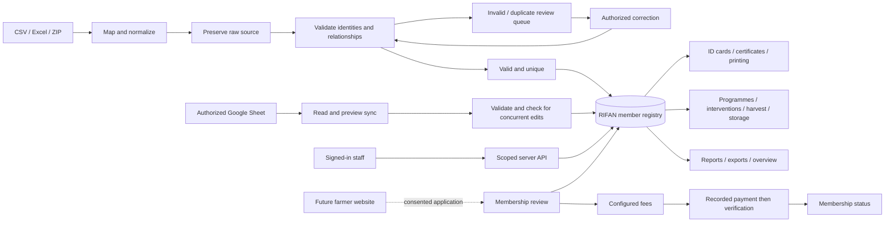

# System analysis and rebuild map

## Original structure

The inspected baseline has 17 page components, a React 19/Vite 6 frontend, an Express gateway, Firebase client/Auth/Firestore stores, Firebase Admin, a separate Firebase Functions deployment, and unused/secondary PostgreSQL/Drizzle scaffolding. Approximately 11,500 lines across page components, UI components, stores and the main server were inventoried, alongside types, validation, connectors, geography, policies and rules.

The main route tree includes dashboard, advisor, login/profile, users, farmers/profile, map, harvest calendar, alerts, food bank, organizations, warehouses, upload, monitoring, audit and settings. Shared components add ID cards, certificates, resource inventory, CSV schema checks, mapping templates, workbook links, dashboard widgets, weather and walkthroughs.

The typical original path was browser → Zustand store → Firestore, with selected Google/Gemini/admin operations through Express. Role tests were distributed across components, a policy module and Firestore rules. Firebase Functions attempted organization/programme referential checks after deletion.

### Behaviors intentionally corrected

- Missing authentication, anonymous sign-in and profile-loading failures could fall back to a hardcoded Super Admin. The protected route only waited for loading; it did not require authentication.
- User provisioning/password failures could still report success or create mock users.
- Some optimistic writes failed after the interface had already implied success.
- Missing coordinates and farm sizes could be replaced with randomly generated values.
- Documents used browser object URLs that did not survive a session.
- Alerts simulated sending; credit scores were explicitly mock calculations.
- Some import staging and external-connector behavior was stubbed.

These behaviors are not copied into the new app as working business functions. Accounts require explicit sign-in; the demo is isolated; writes are acknowledged; locations are never invented; files persist; unavailable external services return explicit errors.

## Reorganized navigation

| Area                       | Modules                                                                    | Purpose                                                          |
| -------------------------- | -------------------------------------------------------------------------- | ---------------------------------------------------------------- |
| Workspace                  | Overview; Members & fees                                                   | Association totals, upcoming actions, membership and collections |
| Farmers & field operations | Registry; Farm intelligence; Harvest planner; Programmes & impact; Advisor | Farmer lifecycle and extension work                              |
| Food security              | Food bank; Warehouses; Cooperatives                                        | Aggregation, storage and partner coordination                    |
| Data & reports             | Data hub; Reports; Connections                                             | Validated ingestion, connected registers and decision support    |
| Administration             | Team & access; Audit; Settings; My account                                 | Account scopes, accountability and configuration                 |

## New structure

```text
rifan-app/
  src/
    App.tsx                 Routes and responsive shell
    model.ts                Entities, roles, forms and shared defaults
    pages/                  Workflow-specific views
    components/             Forms, tables, modals, cards, heat layer, weather
    lib/workspace.tsx       Authenticated requests and refresh/error state
    lib/importing.ts        CSV/ZIP/XLSX parsing and shared normalization
    lib/id-cards.ts         Bulk/single PDFs, ZIP and print preparation
    lib/export.ts           CSV, XLSX and certificate export
    lib/pdf-*.ts            Embedded Unicode fonts and compact print images
    lib/geodata.ts          GeoJSON/KML/GPX/shapefile ingestion
    lib/nigeriaData.ts      Reused states/LGAs and reference coordinates
    lib/crossBorderData.ts  Reused supported neighboring-country geography
  server/
    index.ts                Development/production startup
    api.ts                  Session-authenticated APIs and integrations
    database.ts             SQLite persistence, transactions, audit and demo
    validation.ts           Server-side field and relationship validation
  public/                   RIFAN emblem and print-font assets
  scripts/                  Authorized import, verification and backup tools
  tests/                    API/integration tests and browser checks
  docs/                     Analysis, import outcomes, deployment and evidence
  .data/                    Private database/source files; ignored by Git
```

### Data flow



## Feature/function preservation matrix

| Original capability                                | Rebuilt implementation / change                                                                                                                       |
| -------------------------------------------------- | ----------------------------------------------------------------------------------------------------------------------------------------------------- |
| Executive statistics and trend charts              | Database-wide SQL summaries, cached with mutation/external-connection invalidation; loaded-window counts are never substituted for totals             |
| State/gender/crop/finance reporting                | Reports with state, gender, crop and approved-finance summaries; CSV and Excel export                                                                 |
| Custom dashboard widgets                           | Persisted widget names, source/group/type, visibility, dashboard labels and role restrictions; workspace refresh is every 30 seconds                  |
| Farmer create/edit/delete/search                   | Server-validated forms, filtered database pagination, scoped profile access, referenced-record deletion guards                                        |
| Expanded personal/geographical/farm fields         | Shared form model covering contacts, demographics, geography, production, insurance, finance and membership                                           |
| BVN/NIN/bank information                           | Structural validation, identity duplicate checks, restricted retrieval, masked profile presentation and omission from cards/general exports           |
| Member ID and certificate                          | Auto-generated branded profile card, printable card route, single PDF, combined bulk PDF, individual PDF ZIP and certificate                          |
| Photo and document management                      | Uploaded image portraits and durable authenticated document storage, MIME checks and removal handling                                                 |
| Farm boundaries                                    | Persisted uploaded GeoJSON; KML/GPX/zipped shapefile conversion; no invented polygons                                                                 |
| Resource inventory                                 | Per-farmer input records with types, quantities, units and validated changes                                                                          |
| Interventions and monitoring                       | Per-farmer support, programme links, status, dates, assessed impact and aggregate monitoring                                                          |
| Crop/credit charts                                 | Real crop counts retained. Invented credit scores removed; recorded finance is reported without claiming underwriting                                 |
| Wallet transfers                                   | Replaced with a verified membership-fee ledger; no fake balances or simulated money movement                                                          |
| Organizations/programmes/geofencing                | Cooperatives, programme relationships and server-side organization/state/LGA/warehouse account scopes                                                 |
| Warehouses and food bank                           | Persistent storage registry, capacity utilization, immutable receipts/dispatches and stock guards                                                     |
| GIS, heat maps and satellite overlays              | Recorded coordinate points, heat layer, saved boundaries, OpenStreetMap/Esri/NASA provider layers                                                     |
| Harvest calendar                                   | Actual recorded planting/harvest dates; no inferred maturity dates; forecast component uses explicit state reference locations                        |
| CSV/XLSX upload and field mapping                  | Shared parser, explicit encoding handling, sheet selection, mappings, source archive, validation and correction workflow                              |
| Google Sheets register                             | Authorized source reads, worksheet selection, create/update previews, conflict checks, batched export to a dedicated tab                              |
| Mapping/required-field templates                   | Persisted reusable mapping JSON and required-field configuration; required core server rules cannot be disabled                                       |
| Connected workbooks/Drive                          | Workbook linking/creation and authorized folder selection                                                                                             |
| Google Forms/Docs                                  | Real provider endpoints; Forms responses require a linked response spreadsheet; no automatic response-sync claim                                      |
| Alerts and notification delivery                   | Rule-generated harvest/KYC priorities, resolution, authorized Gmail provider acceptance; SMS remains unconfigured                                     |
| AI advisor/chat                                    | Configurable Gemini model and persisted conversations; no API key means an explicit unavailable response                                              |
| Weather                                            | Seven-day Open-Meteo forecast on request, with explicit provider failures                                                                             |
| Authentication, seven roles and account management | Scrypt password hashes, expiring HttpOnly sessions, scoped server authorization, account lifecycle and session invalidation                           |
| Audit trail                                        | Transaction-linked, append-only API history with sensitive identity values excluded                                                                   |
| Branding, themes, flags and tour                   | RIFAN name, forest green/gold palette, page/card watermarks, light/dark preference, module flags and workspace guide                                  |
| Offline indicator                                  | Loaded records remain viewable offline; saving needs a confirmed connection. Unconfirmed writes are not labeled saved                                 |
| Firebase/Functions rules                           | Replaced for the separate RIFAN database by API authorization, transactions and pre-deletion referential checks                                       |
| PostgreSQL scaffold                                | Not connected: the selected independent cloud workflow runs on SQLite. A multi-instance production database migration is a separate deployment choice |

## Validation and usage policy

Human-readable farmer names and descriptive text are normalized to CAPITAL LETTERS; record-value presentation is uppercase. Original upload rows remain unchanged. Passwords, email addresses, URLs, opaque IDs, keys, mapping JSON and canonical enum keys retain their required representations.

Validation covers required names/phones, real calendar dates, future birth dates, coordinate pairs/ranges, nonnegative quantities, recognized country/state/LGA relationships, supported enums, organization/programme references and duplicate member identifiers. BVN/NIN checks validate format and uniqueness, not NIBSS identity proof. Stored source verification claims stay separate from confirmed RIFAN identity checks.

Known, reviewed aliases normalize Abuja → FCT, Oturkpo → Otukpo in Benue, Larmurde → Lamurde in Adamawa and specified FCT/Kwara labels. Conflicting state/LGA combinations remain rejected. Nigerian phone formatting can restore an omitted leading zero only for a recognized ten-digit mobile pattern; rounded scientific notation and date-corrupted phone cells are not guessed.

Membership payment records require positive two-decimal amounts, unique transaction references and configured fees. Only verified entries count. Warehouse movements cannot exceed reserve stock or capacity, and referential constraints prevent deleting linked records.
